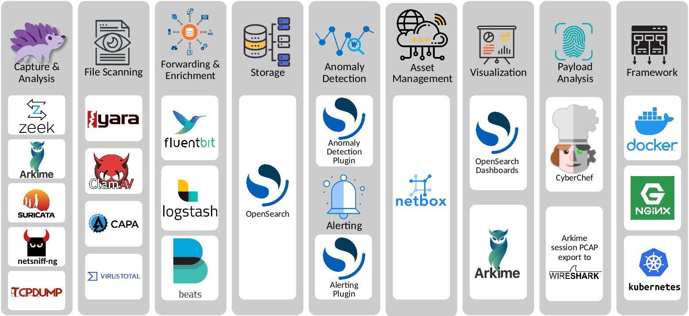

# Malcolm Code Provenance and Software Supply Chain

The purpose of this document is to outline general practices for ensuring that open source software included in Malcolm comes from trustworthy sources.

* [Code and Release Artifacts](#CodeAndReleaseArtifacts)
* [Upstream Components](#UpstreamComponents)
    - [Base Images for Containers and Installed Environments](#BaseImagesForContainersAndInstalledEnvironments)
        + [Container Images](#ContainerImages)
        + [ISO-Installed Environments](#ISOInstalledEnvironments)
    - [Software Package Repositories](#SoftwarePackageRepositories)
        + [Linux Distribution Package Repositories](#LinuxDistroRepos)
        + [Python Package Index (PyPI)](#PyPI)
        + [Binary Release Artifacts on GitHub](#GitHubReleaseArtifacts)
    - [Code Built From Source](#CodeBuiltFromSource)
    - [Standards of Trust for Providers of Upstream Code](#StandardsOfTrustForProvidersOfUpstreamCode)
    - [Incorporating Updates to Third-Party Code](#SoftwareUpdates)
        + [Version Pinning](#VersionPinning)
        + [Verifying Downloaded Artifacts](#VerifyingDownloads)
        + [Signature Verification for Third-Party Package Repositories](#SignatureVerification)
        + [Updating a Pin](#UpdatingAPin)
* [Code Submissions (Pull Requests)](#CodeSubmissionsPullRequests)
* [Security Vulnerability Scanning](#SecurityVulnerabilityScanning)

##  Code and Release Artifacts

Malcolm's source code and release artifacts are made up of the following:

* container images for Docker/Podman/Kubernetes
    - These contain the majority of the "brains" of Malcolm, and are used as the basis of all deployment models, whether ISO-installer based, Docker/Podman based, or cloud (Kubernetes) based.
* Desktop OS environments for [Malcolm](malcolm-hedgehog-e2e-iso-install.md#MalcolmDesktop) and Hedgehog Linux
    - These are ISO-installed environments that are primarily used for bare-metal or virtual machine installations. They include the container images mentioned above.
* The actual "[Malcolm source code](({{ site.github.repository_url }}))", which includes:
    - [scripts]({{ site.github.repository_url }}/tree/{{ site.github.build_revision }}/scripts/) for installing and configuring Malcolm
    - "recipes" and contents used for building images
        + [container]({{ site.github.repository_url }}/tree/{{ site.github.build_revision }}/Dockerfiles/) images
        + [Malcolm]({{ site.github.repository_url }}/tree/{{ site.github.build_revision }}/malcolm-iso) ISO installer
        + [Hedgehog Linux]({{ site.github.repository_url }}/tree/{{ site.github.build_revision }}/hedgehog-raspi) Raspberry Pi image
    - [documentation]({{ site.github.repository_url }}/tree/{{ site.github.build_revision }}/docs)
    - [configuration files]({{ site.github.repository_url }}/tree/{{ site.github.build_revision }}/config) storing user preferences

##  Upstream Components

Malcolm is a tool suite that incorporates many open source components (some of which are listed [here](components.md#Components)).

###  Base Images for Containers and Installed Environments

The main sources of Malcolm's core tools and libraries are the 'base images' on which Malcolm is built. These base images are defined in:

* [Dockerfiles]({{ site.github.repository_url }}/tree/{{ site.github.build_revision }}/Dockerfiles/) used to build container images
* scripts that use the [Debian Live](https://www.debian.org/devel/debian-live/) framework to build the x86_64 ISO and ARM64 [Raspberry Pi installer](hedgehog-raspi.md#HedgehogRaspiBuild) images

####  Container Images

Malcolm uses the official container images curated by Docker Hub or maintained by the developers of the various projects they represent.

The base images used to build Malcolm's images are:

* [alpine](https://hub.docker.com/_/alpine) (Docker Official Image)
* [debian](https://hub.docker.com/_/debian) (Docker Official Image)
* [docker.elastic.co](https://www.docker.elastic.co/)/[beats](https://www.docker.elastic.co/r/beats)/filebeat-oss (Elasticsearch Official Image)
* [docker.elastic.co](https://www.docker.elastic.co/)/[logstash](https://www.docker.elastic.co/r/logstash)/logstash-oss (Elasticsearch Official Image)
* [netboxcommunity/netbox](https://hub.docker.com/r/netboxcommunity/netbox) (Official Community-Maintained Docker-Sponsored OSS Image)
* [opensearchproject/opensearch](https://hub.docker.com/r/opensearchproject/opensearch) (Docker-Verified Official Publisher Image)
* [opensearchproject/opensearch-dashboards](https://hub.docker.com/r/opensearchproject/opensearch-dashboards) (Docker-Verified Official Publisher Image)
* [postgres:alpine](https://hub.docker.com/_/postgres) (Docker Official Image)
* [python:3-slim](https://hub.docker.com/_/python) (Docker Official Image)
* [valkey:alpine](https://hub.docker.com/r/valkey/valkey) (Docker Official Image)

As described on the [Docker Hub documentation](https://docs.docker.com/docker-hub/image-library/trusted-content/):

> Docker Hub's trusted content provides a curated selection of high-quality, secure images designed to give developers confidence in the reliability and security of the resources they use. These images are stable, regularly updated, and adhere to industry best practices, making them a strong foundation for building and deploying applications. Docker Hub's trusted content includes, Docker Official Images, Verified Publisher images, and Docker-Sponsored Open Source Software images.

Using these official images as the base of Malcolm's Docker images relies on a trusted upstream provider (Docker, Elasticsearch, NetBox, etc.) to provide a secure foundation upon which Malcolm is built. The images listed above are used by tens of thousands of organizations, projects, and developers worldwide.

####  ISO-Installed Environments

For the ISO installers for [Malcolm](malcolm-iso.md#ISOInstallation) and [Hedgehog Linux](hedgehog.md), and the [Hedgehog Linux Raspberry Pi Image](hedgehog-raspi.md#HedgehogRaspiBuild), Malcolm uses the [Debian Live](https://www.debian.org/devel/debian-live/) framework to build installation images based on Debian stable, which, as described in the [Debian FAQ](https://www.debian.org/doc/manuals/debian-faq/choosing.en.html#s3.1.5), "is rock solid. It does not break and has full security support."

Beyond building on this solid foundation, and as these environments are full-fledged operating systems, the Malcolm aggregator base operating system uses the [harbian-audit](https://github.com/hardenedlinux/harbian-audit) hardening scripts, which target Debian GNU/Linux 9 through 13. The project builds on the [OVH-debian-cis](https://github.com/ovh/debian-cis) framework and implements checks from:

* CIS recommendations
* DISA STIG for Red Hat Enterprise Linux 7 (V2R5) and Ubuntu (V1R2), adapted for Debian
* Additional checks contributed by the HardenedLinux community

More details on this hardening can be found [here for Malcolm](hardening.md).

###  Software Package Repositories

####  Linux Distribution Package Repositories

Whenever possible, Malcolm's container images and ISO installers install any additional software packages from the software repositories officially maintained by the underlying OS of the image. For example:

* [Alpine](https://wiki.alpinelinux.org/wiki/Repositories)'s official repositories supported by the Alpine Linux core team
* [Debian](https://wiki.debian.org/DebianRepository#Mirrors)'s official repositories curated by the Debian team
* [Amazon Linux 2023](https://docs.aws.amazon.com/linux/al2023/ug/what-is-amazon-linux.html)'s official repositories maintained by the Amazon Web Services (AWS) team, drawing from the Fedora and CentOS repositories upstream
* [Ubuntu](https://help.ubuntu.com/community/Repositories/Ubuntu)'s official repositories maintained by Canonical

Packages installed from these official Linux repositories are generally considered safe, as they undergo rigorous testing and security checks by the distribution maintainers, making them a reliable source for software installation compared to downloading from unknown third-party sources. As software bugs and vulnerabilities are discovered the affected packages are patched upstream and included in subsequent Malcolm releases.

####  Python Package Index (PyPI)

The other type of software repository used in Malcolm's image is [PyPI](https://pypi.org/), the Python Package Index. When official packages for Python libraries are not provided in the previously-mentioned repositories provided by Debian, Alpine, etc., they are published to PyPI by the creator of those libraries. PyPI is *not* inherently safe to the level that the official Linux distributions' packages repositories aim to be. For this reason, extra steps must be taken to ensure the additional Python libraries included in Malcolm are trustworthy. See [**Standards of Trust for Providers of Upstream Code**](#StandardsOfTrustForProvidersOfUpstreamCode) for more details.

####  Binary Release Artifacts on GitHub

To reduce build time, some small standalone tools included in Malcolm are downloaded as binaries released in their respective projects' official [GitHub releases](https://docs.github.com/en/repositories/releasing-projects-on-github/about-releases). The same [**Standards of Trust for Providers of Upstream Code**](#StandardsOfTrustForProvidersOfUpstreamCode) apply for these artifacts as for binaries [compiled from source](#CodeBuiltFromSource) during the Malcolm build. Each of these artifacts is pinned to a specific release version and verified against a SHA-256 digest recorded in the Malcolm source tree before it is installed; see [**Verifying Downloaded Artifacts**](#VerifyingDownloads).

###  Code Built From Source

Some packages in Malcolm are not available as precompiled binaries and must be built from source. In order to ensure the code compiled is of legitimate origin, it is always downloaded directly from its originator (i.e., the author or organization that has released the source code). Usually this means downloading it from GitHub or from an organization's official website over HTTPS. Source archives are pinned to a specific release version or Git commit and verified against a SHA-256 digest before they are extracted and built; see [**Version Pinning**](#VersionPinning) and [**Verifying Downloaded Artifacts**](#VerifyingDownloads). See [**Standards of Trust for Providers of Upstream Code**](#StandardsOfTrustForProvidersOfUpstreamCode) for more details about determining trustworthiness of third-party code.

###  Standards of Trust for Providers of Upstream Code

Determining the trustworthiness of third-party source code is essential for maintaining the security and integrity of Malcolm's software supply chain.

#### Community Size and Activity

One key factor used to evaluate a project's suitability for inclusion in Malcolm is the size and activity of the project's community. Open-source projects with active issue tracking, regular releases, and responsive maintainers are generally more reliable than those with little engagement. A strong community presence — evident through GitHub stars, pull requests, discussions in Slack channels, or forums — indicates that many developers are invested in the project's health, making it less likely that malicious code goes unnoticed. Frequent updates and well-documented changes also suggest that the maintainers are proactive in addressing security vulnerabilities and improving the software.

#### Popularity and Adoption

Another critical aspect is project popularity and adoption. The more widely used a piece of software is, the more scrutiny it receives from developers, security researchers, and organizations relying on it. Large-scale adoption reduces the likelihood of undetected vulnerabilities or hidden backdoors since many independent contributors and companies have a vested interest in keeping the project secure. However, popularity alone isn't enough — it's important to check if reputable organizations use the project and whether they contribute back to its development. Reviewing security audits, dependency transparency, and any history of security incidents can further help in assessing whether a project can be trusted.

#### Technical Security

Beyond community activity and popularity, other technical factors should be considered. Reviewing a candidate project's dependency tree can reveal if it relies on well-maintained and trusted libraries or if it introduces risky, obscure dependencies. Checking for reproducible builds and signed releases ensures that the distributed code matches the source and hasn't been tampered with. Additionally, verifying that the project follows security best practices — such as enforcing code reviews, providing cryptographic signatures for releases, and maintaining a clear disclosure process for vulnerabilities — can provide confidence in its reliability.

#### Relationships of Trust

Finally, the Malcolm team has developed professional working relationships and friendships with some of the teams behind many Malcolm components. Malcolm developers are active members of many of the communities surrounding those projects, and know those working on the code. This familiarity bolsters the Malcolm team's confidence and trust in those projects.

By combining these factors, the Malcolm team can make informed decisions about integrating third-party code into Malcolm.

###  Incorporating Updates to Third-Party Code

For software that is installed via [Linux distributions' package repositories](#LinuxDistroRepos), the Malcolm developers mostly take a "hands-off" approach: these packages are included in new Malcolm builds automatically as they are updated upstream. Infrequently, when a new major version of a base image is released (for example, the next stable release of Debian every few years or a new image for the next release of Alpine Linux), the Malcolm team will review changelogs and release notes and manually bump the Malcolm dependency up to the latest version. This is advisable as most new releases of distributions include improvements to features, performance, and security.

[Python libraries](#PyPI) used in Malcolm are all ["pinned"](https://pip.pypa.io/en/stable/topics/repeatable-installs/#pinning-the-package-versions) to a specific version which is manually updated when [a security vulnerability](#SecurityVulnerabilityScanning) is reported, new functionality is added, or for other reasons at a Malcolm developer's discretion. Package pinning helps prevent unexpected bugs or compatibility issues when new versions are released.

For other components of Malcolm, whether they are major components ([Arkime](https://github.com/arkime/arkime/releases), [OpenSearch](https://docs.opensearch.org/latest/version-history/), [Zeek](https://github.com/zeek/zeek/releases), etc.) or smaller tools ([Tini](https://github.com/krallin/tini/releases), [yq](https://github.com/mikefarah/yq), [supercronic](https://github.com/aptible/supercronic)), the Malcolm team stays abreast of new releases primarily through [GitHub notifications](https://docs.github.com/en/account-and-profile/managing-subscriptions-and-notifications-on-github/setting-up-notifications/about-notifications) triggered when a new release of that component is published. A Malcolm developer reviews the release notes accompanying new releases before deciding if and when to update the version included in Malcolm. The thoroughness of this review — from a cursory perusal of the release notes to a more in-depth review of the changed code itself — will vary depending on the team's familiarity and experience with the project in question.

New releases are always tested locally and with [`malcolm-test`](contributing-malcolm-test.md#MalcolmTest), the Malcolm system test suite, before they are merged into the main Malcolm source code repository for inclusion in a Malcolm release.

####  Version Pinning

Third-party artifacts that end up in a published Malcolm image or installed environment are identified by an exact version, tag, or Git commit recorded in the Malcolm source tree, rather than by a floating tag or a branch name that resolves to whatever was most recently pushed upstream.

In practice this takes a few forms:

* release versions in the [Dockerfiles]({{ site.github.repository_url }}/tree/{{ site.github.build_revision }}/Dockerfiles/) (for example, `ARKIME_VERSION="6.9.1"`, `SUPERCRONIC_VERSION="0.2.51"`, `YQ_VERSION="4.54.1"`, `OPENRESTY_VERSION=1.31.1.1`) and in the ISO and Raspberry Pi build hooks
* immutable Git commit SHAs where a project's source tree is consumed directly rather than through a release artifact. The nginx image builds the `nginx-auth-ldap` module and the `lua-resty-*` OpenID Connect module stack from pinned commits, and the htadmin, NetBox devicetype-library, ECS, and FilePond server sources are fetched by commit rather than by branch.
* image digests (`@sha256:…`) on the `FROM` and `COPY --from` references to Malcolm's own helper images (`gostatic`, `jekyll`) and to the Strelka images, which ties the build to specific image content even though the tag they carry is `latest`
* exact versions on packages installed through language package managers outside of PyPI, such as the `filepond` and `@jcubic/tagger` npm packages in the file-upload image and `redis@6.3.0` in the Zeek image

Zeek plugins get their own two-file arrangement, because there are enough of them that pinning each one by hand in the install script would be unmanageable. [`zeek/zeek-packages.list`]({{ site.github.repository_url }}/tree/{{ site.github.build_revision }}/zeek/zeek-packages.list) is the human-edited input: one line per package, giving the repository URL and optionally a branch, tag, or commit to track, any environment variables needed for the install, and whether to install through `zkg` or as a plain Git checkout. [`scripts/zeek_packages_lock_refresh.sh`]({{ site.github.repository_url }}/tree/{{ site.github.build_revision }}/scripts/zeek_packages_lock_refresh.sh) resolves every entry in that list to a specific commit and writes [`zeek/zeek-packages.lock`]({{ site.github.repository_url }}/tree/{{ site.github.build_revision }}/zeek/zeek-packages.lock), which records the URL, the resolved commit, and the ref that commit came from. The build installs only what the lock file names.

That split matters for provenance. An entry in the list may deliberately track something that moves, and an entry with no ref at all follows `zkg`'s own default behavior of taking the latest GitHub release, falling back to the highest version tag, then to the default branch. Resolving the list to a lock file is what converts those moving targets into commits, so adding or changing a package is a two-step operation: edit the list, run the refresh script, then review the resulting lock file diff as part of the change.

The nginx image is worth calling out specifically: the LDAP module and the OIDC Lua modules execute inside the authentication reverse proxy, so an unreviewed upstream change there would sit directly in Malcolm's authentication path. Those pins carry a comment in the Dockerfile explaining why the build must reject a changed source archive rather than quietly compile a new branch HEAD.

Two things are deliberately left unpinned. Base images from the upstream distributions and projects are pinned to a major or minor version (`debian:13-slim`, `alpine:3.24`, `python:3.13-slim-trixie`) rather than to a digest, so that security updates from those maintainers flow into Malcolm builds as described at the top of this section. A handful of intermediate build stages that only produce artifacts copied into a final image, such as the `redhat/ubi9` stages used to assemble a minimal root filesystem, still reference `:latest`.

####  Verifying Downloaded Artifacts

Pinning a version answers the question of *which* artifact the build wants. It does not establish that the bytes that arrive over the network are the bytes the Malcolm team reviewed. Verification of a cryptographic digest closes that gap, and covers the cases where a release asset is re-uploaded under the same tag, a CDN or mirror serves something unexpected, or a download is corrupted or intercepted in transit.

Binary release artifacts are installed through [`shared/bin/install-verified-binary.sh`]({{ site.github.repository_url }}/tree/{{ site.github.build_revision }}/shared/bin/install-verified-binary.sh), a small helper that takes a destination path, an HTTPS download URL, and an artifact name. It looks up the expected SHA-256 for that artifact in [`shared/checksums/binaries.sha256`]({{ site.github.repository_url }}/tree/{{ site.github.build_revision }}/shared/checksums/binaries.sha256), downloads to a temporary file, verifies the complete file, and only then installs it to its destination. The helper fails closed throughout: a non-HTTPS URL, a missing manifest, a missing or duplicated manifest entry, a malformed digest, or a checksum mismatch each abort the build rather than fall back to installing an unverified file. Both the helper and the manifest are supplied to each `RUN` instruction as read-only bind mounts, so they never become layers in the published image.

The same helper and the same manifest are used by the container builds, the [ISO build]({{ site.github.repository_url }}/tree/{{ site.github.build_revision }}/malcolm-iso), and the [Hedgehog Linux Raspberry Pi]({{ site.github.repository_url }}/tree/{{ site.github.build_revision }}/hedgehog-raspi) build, which copy `binaries.sha256` into the build environment. Artifacts covered by the manifest include the Arkime `.deb` packages and the JA4+ plugin, `tini`, `yq`, `supercronic`, `evtx_dump`, `kubectl`, `stern`, `croc`, `just`, `eza`, the Nerd Fonts Hack archive, and the `pip` wheel used to bootstrap NetBox's virtual environment. The manifest records separate digests for amd64 and arm64 where a project ships per-architecture assets, and the helper selects the right entry based on the build host's architecture.

Source tarballs and other downloads not covered by the shared manifest are verified against a digest recorded alongside the version pin in the Dockerfile that uses them. This applies to the OpenResty release tarball, the htadmin archive, the ECS source, the NetBox devicetype-library and its import tool, the FilePond server, the `freq_server` source, and the htpdate source shared between the ISO and Raspberry Pi builds. Where BuildKit can do the work itself, the nginx image uses `ADD --checksum=sha256:…`, which covers the Lua module and LDAP module source archives along with the fonts, icons, and other static web assets fetched from CDNs and upstream project sites.

The htadmin image takes verification a step further. Its web assets are discovered by scraping URLs out of the upstream PHP source, so the build cannot name every file in advance. Instead it compares the set of files it actually downloaded against the file list in [`shared/checksums/htadmin-assets.sha256`]({{ site.github.repository_url }}/tree/{{ site.github.build_revision }}/shared/checksums/htadmin-assets.sha256) and fails if the two differ, then verifies each file's SHA-256. An upstream change that adds, removes, or renames an asset stops the build instead of silently pulling in an unverified file.

####  Signature Verification for Third-Party Package Repositories

A few images install packages from repositories outside the base image's own distribution. These use the repository's signing key rather than per-file checksums, since the package manager already verifies signatures once the key is trusted.

The filebeat and logstash images install from EPEL. The EPEL signing key is committed to the Malcolm repository as [`shared/keys/RPM-GPG-KEY-EPEL-9`]({{ site.github.repository_url }}/tree/{{ site.github.build_revision }}/shared/keys/RPM-GPG-KEY-EPEL-9) and bind-mounted into the build, imported with `rpm --import`, and the `epel-release` package is then installed with `--define '_pkgverify_level all'` so RPM refuses anything unsigned or signed by an unexpected key. Committing the key means the build trusts a key the Malcolm team reviewed, rather than whatever key happens to be served alongside the package at build time.

On Hedgehog Linux, the Fluent Bit and Docker APT repositories are configured with `signed-by` pointing at keyrings dearmored from key files carried in the Malcolm source tree. Each repository can only install packages signed by its own key, which prevents one third-party repository from supplying packages that appear to belong to another.

####  Updating a Pin

Because a version pin and its digest describe the same artifact, they are always updated together in a single commit, and the Dockerfiles and manifests carry comments to that effect. A version bump without the matching digest update fails the build rather than installing an unverified artifact, which is the intended behavior: the failure is noisy and local, and it happens before anything unreviewed reaches an image.

The practical workflow for a developer updating a dependency is:

1. review the upstream release notes and, as appropriate, the changed code, as described above
2. bump the version, tag, or commit SHA where it is pinned
3. recompute the SHA-256 of the new artifact and update `shared/checksums/binaries.sha256`, the per-Dockerfile digest, or the `ADD --checksum` value. The nginx Dockerfile includes a short `pin()` shell function in its comments for resolving a Git tag to a commit SHA and computing the archive digest in one step. For Zeek packages, edit `zeek/zeek-packages.list` instead, then run `scripts/zeek_packages_lock_refresh.sh` and review the `zeek/zeek-packages.lock` diff.
4. build and test locally and with [`malcolm-test`](contributing-malcolm-test.md#MalcolmTest) before opening a pull request

Pull request review covers the pinning and verification changes along with everything else. A new upstream dependency is expected to arrive pinned and verified by one of the mechanisms above, and a change that loosens an existing pin or drops a verification step needs an explanation of why.

##  Code Submissions (Pull Requests)

Malcolm, like other open source projects, occasionally receives code contributions from external parties. In source control parlance, these contributions are submitted as [pull requests](https://docs.github.com/en/pull-requests/collaborating-with-pull-requests/proposing-changes-to-your-work-with-pull-requests/about-pull-requests).

Regardless of their origin or complexity, each pull request is carefully and thoroughly [reviewed](https://docs.github.com/en/pull-requests/collaborating-with-pull-requests/reviewing-changes-in-pull-requests/about-pull-request-reviews) by Malcolm developers, who:

* review every change, line-by-line, proposed in the pull request
* review the history (involvement in other communities on GitHub, contributions to other projects, their own repositories, etc.) of the party submitting the pull request to make, as much as possible, a determination that they're legitimate
* pay careful attention to identify new dependencies added by the pull request and apply the same [standards of trust for providers of upstream code](#StandardsOfTrustForProvidersOfUpstreamCode) should there be any, and confirm that any new upstream artifact is [pinned and verified](#SoftwareUpdates)
* never accept any pull request with binary artifacts, which cannot be reviewed in the same way source code can
* test the changes locally before accepting the pull request
* resolve any concerns before accepting the pull request
* get sign-off from a senior Malcolm developer before accepting the pull request

Pull requests that follow [best practices](https://docs.github.com/en/pull-requests/collaborating-with-pull-requests/getting-started/helping-others-review-your-changes), are [well-written](https://github.blog/developer-skills/github/how-to-write-the-perfect-pull-request/), and bring value to the Malcolm project are likely to be accepted once the criteria above have been met. If potential contributors are considering working on a significant pull request, it is always a good idea to reach out on the [Malcolm discussions board](https://github.com/cisagov/Malcolm/discussions) to touch base with the Malcolm team first.

##  Security Vulnerability Scanning

When Malcolm's official container images are [built on GitHub](contributing-github-runners.md#GitHubRunners), they are automatically scanned with [Trivy](https://trivy.dev/docs/latest/). Trivy can "find vulnerabilities (CVE) & misconfigurations (IaC) across code repositories, binary artifacts, container images, Kubernetes clusters, and more." When Trivy detects a vulnerability in a software package included in Malcolm, a report is automatically generated and uploaded to the Malcolm repository's [code scanning](https://docs.github.com/en/code-security/code-scanning/introduction-to-code-scanning/about-code-scanning) dashboard on GitHub. These are periodically reviewed and addressed (by updating to a newer version of the affected dependency if it has become available, by applying other safeguards in the code to avoid the affected functionality, replacing the dependency with another alternative, or other solutions as determined on a case-by-case basis) by the Malcolm development team.

In addition to this proactive vulnerability scanning, GitHub also sends [Dependabot alerts](https://docs.github.com/en/code-security/dependabot/dependabot-alerts/about-dependabot-alerts) when it detects a vulnerable dependency in the Malcolm code base. These are also addressed as they arise.